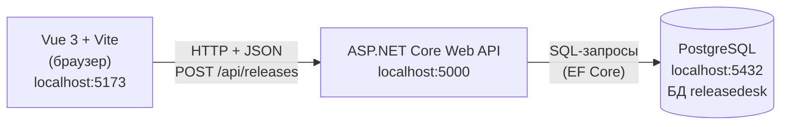

# Архитектура ReleaseDesk

Курс: Б1.В.ДЭ.01.02.02 · КГЭУ · 2026/2027 · ЛР2  
Студент: Шафиков Тимур Фидаилевич · Группа: ТРИС-3-23

## Схема из трёх узлов



```text
Vue 3 + Vite             ASP.NET Core              PostgreSQL
localhost:5173  ───────► localhost:5000  ───────► localhost:5432
                  HTTP                    запросы к БД
       пример: POST /api/releases
```

**архитектура web-ИС семестра**

## Кто за что отвечает

| Узел | Порт | Отвечает за |
|------|------|-------------|
| Vue 3 + Vite | 5173 | три экрана (вход, список заявок на публикацию, создание заявки); отправляет HTTP-запросы с JSON и показывает ответ |
| ASP.NET Core Web API | 5000 | проверяет поля и права ролей (кто создаёт, кто назначает, кто двигает статус), выдаёт `number`, хранит правила переходов статусов |
| PostgreSQL | 5432 | хранит таблицы `stores`, `users`, `releases`; данные переживают перезапуск сервера (НФТ-1) |

## Почему браузер не ходит в PostgreSQL напрямую

Прямой стрелки браузер → БД нет. Если бы Vue подключался к базе сам, логин и пароль от БД оказались бы в коде страницы, и любой пользователь мог бы прочитать или изменить любую заявку в обход правил. Тогда релиз-инженер смог бы перевести чужую заявку в «Опубликовано», а запреты ФТ-9 и ФТ-10 из ЛР1 не работали бы. Все правила проверяет только сервер ASP.NET Core, и только он знает строку подключения к PostgreSQL.
