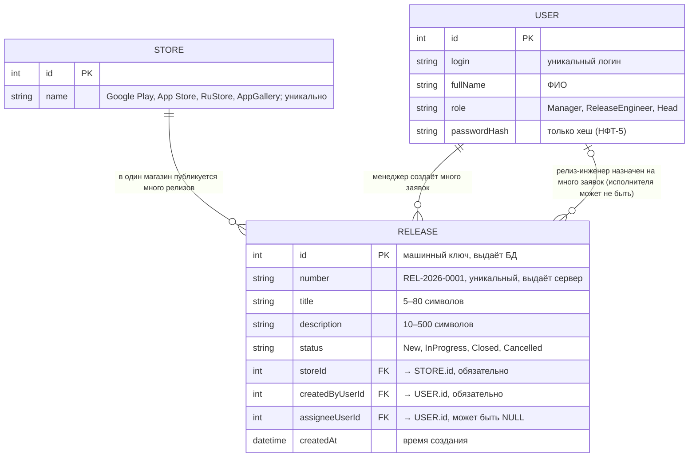

# Модель данных ReleaseDesk

Курс: Б1.В.ДЭ.01.02.02 · КГЭУ · 2026/2027 · ЛР2  
Студент: Шафиков Тимур Фидаилевич · Группа: ТРИС-3-23

## Словарь проекта

Эти имена дальше используются в Vue, C# и SQL без замен.

| Термин курса | Термин моей темы | Сущность в коде | Таблица в БД |
|--------------|------------------|-----------------|--------------|
| Ticket | заявка на публикацию релиза | `Release` | `releases` |
| Site | магазин приложений | `Store` | `stores` |
| User | пользователь: менеджер проекта / релиз-инженер / руководитель направления | `User` | `users` |
| `siteId` | ссылка на магазин | `storeId` | `store_id` |
| `/api/tickets` | путь API | `/api/releases` | — |

## ER-диаграмма

## Сущности и поля

### Store — магазин приложений (справочник)

| Поле | Тип | Ключ | Обязательно | Комментарий |
|------|-----|------|-------------|-------------|
| `id` | int | PK | да | машинный ключ |
| `name` | text | — | да, уникально | «Google Play», «App Store», «RuStore», «AppGallery» |

### User — пользователь

| Поле | Тип | Ключ | Обязательно | Комментарий |
|------|-----|------|-------------|-------------|
| `id` | int | PK | да | машинный ключ (не фамилия) |
| `login` | text | — | да, уникально | логин для входа |
| `fullName` | text | — | да | ФИО для отображения |
| `role` | text | — | да | `Manager`, `ReleaseEngineer` или `Head` |
| `passwordHash` | text | — | да | хеш пароля, сам пароль не хранится |

### Release — заявка на публикацию релиза (главный объект)

| Поле | Тип | Ключ | Обязательно | Кто заполняет |
|------|-----|------|-------------|---------------|
| `id` | int | PK | да | БД |
| `number` | text | — | да, уникально | сервер, формат `REL-<год>-<4 цифры>` |
| `title` | text (5–80) | — | да | менеджер проекта |
| `description` | text (10–500) | — | да | менеджер проекта |
| `status` | text | — | да | сервер ставит `New`, дальше меняет релиз-инженер или менеджер (отмена) |
| `storeId` | int | FK → `Store.id` | да | менеджер проекта (выбор из списка) |
| `createdByUserId` | int | FK → `User.id` | да | сервер, по вошедшему пользователю |
| `assigneeUserId` | int | FK → `User.id` | **нет** | менеджер проекта отдельным действием |
| `createdAt` | timestamp | — | да | сервер |

## Связи словами

- Один магазин — много заявок на публикацию (1:N, `Release.storeId` → `Store.id`).
- Один пользователь (менеджер проекта) создаёт много заявок (1:N, `Release.createdByUserId` → `User.id`).
- Один пользователь (релиз-инженер) может быть назначен на много заявок (1:N, `Release.assigneeUserId` → `User.id`).
- У новой заявки исполнитель может отсутствовать: `assigneeUserId` = `NULL`, пока менеджер его не назначил.

## `id` и `number` — разные поля

`id` — машинный первичный ключ, его используют внешние ключи и URL API (`/api/releases/17`). `number` — человеческий номер `REL-2026-0017`, который менеджер называет заказчику и в чате. Номер не используется как ключ и не приходит от клиента.

## Статусы

| Код в API и БД | Подпись на экране | Переход из | Кто переводит |
|----------------|-------------------|------------|---------------|
| `New` | Новая | — (ставит сервер при создании) | — |
| `InProgress` | Публикуется | `New` | назначенный релиз-инженер |
| `Closed` | Опубликовано | `InProgress` | назначенный релиз-инженер |
| `Cancelled` | Отменена | `New` (менеджер) или `InProgress` (свой релиз-инженер) | менеджер / релиз-инженер |

`Closed` и `Cancelled` — конечные: из них никуда не переходят. Отмена — это статус `Cancelled`, строка не удаляется.

## Проверка 3НФ

Название магазина хранится в сущности Store один раз. Release содержит только внешний ключ `storeId`. Если магазин переименуют (например, AppGallery сменит название), меняется одна строка в `stores`, а в заявках текст названия не дублируется. Так же ФИО менеджера и релиз-инженера хранится только в `users`, а в заявке лежат числа `createdByUserId` и `assigneeUserId`. Каждое неключевое поле Release зависит только от его `id`, и ни одно не выводится из другого неключевого поля, поэтому модель находится в 3НФ.
